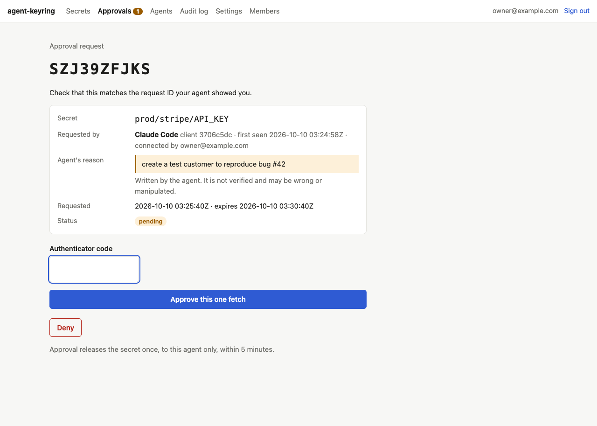

# agent-keyring

A secrets vault for people who work with AI agents. You decide, secret by secret,
whether an agent may fetch it on its own (`open`) or only after you approve that
one fetch (`approval`). Agents connect over OAuth 2.1 to a remote MCP server, so
connecting Claude Code is one command and a consent screen.

```
claude mcp add --transport http agent-keyring https://keyring.example.com/mcp
```

- **Per-secret policy, enforced server-side.** A prompt-injected agent can ask for
  anything in its scope. It still only gets `pending_approval` for approval secrets.
- **One-time, request-bound approvals.** The agent's request shows up on the
  vault's own page with the secret, the client and the agent's stated reason.
  You approve with a Google Authenticator code or a passkey. The approval
  releases the value once, to that agent, within 5 minutes.
- **Folders and scoped grants.** When you connect an agent you pick one folder
  (subfolders included) and can narrow further by tag or exact path. Every grant
  is listed in the UI with one-click revoke.
- **TOTP seeds agents never see.** Store a third-party MFA seed and agents get only
  the current 6-digit code.
- **Envelope encryption.** A fresh data key per secret, wrapped by a master key in
  GCP KMS or AWS KMS. The database alone is useless.
- **Audit log** of every list, fetch, request, approval, denial, grant, revocation
  and policy change, with the agent's reason. Never values, codes or tokens.
- **Self-host it, or run it managed.** One codebase: a single-owner keyring with an
  email allowlist, or a multi-tenant service where each Google account gets its own
  workspace.



## Quickstart (local, about two minutes)

Requirements: Node 22+. Docker is optional.

```bash
git clone https://github.com/devonpmack/agent-keyring && cd agent-keyring
npm install
cp .env.example .env
# No Docker? Use embedded Postgres instead of the URL in .env:
echo 'DATABASE_URL=pglite:.data/pglite' >> .env
npm run dev:google &   # fake Google sign-in on :8091 (development only)
npm run dev            # http://localhost:8080
```

Or run everything in containers: `docker compose up`, then open http://localhost:8080.

Sign in as `owner@example.com` (the fake Google accepts any address; only the
allowlisted owner gets in). Then:

1. **Settings → Set up authenticator.** Scan the QR code with Google Authenticator.
2. **Secrets → New secret.** Use fake values, for example `prod/stripe/API_KEY` = `sk_test_FAKE`,
   policy *Approval*.
3. Connect an agent (below), ask it for the secret, and approve on the page it links to.

Local development uses the `local` KMS adapter (a key file under `.data/`) and
a fake Google. Both are refused when `NODE_ENV=production`.

## Connect Claude Code

```bash
claude mcp add --transport http agent-keyring http://localhost:8080/mcp
```

In Claude Code, run `/mcp` and choose **agent-keyring → Authenticate**. Your
browser opens the keyring's consent page: pick the folder this agent may see,
then **Allow**. Claude Code registers itself via dynamic client registration and
uses PKCE, so there is nothing to copy or paste.

Then ask, for example: *"Use agent-keyring to get prod/stripe/API_KEY and list
my Stripe customers."* For an approval secret, Claude shows you a link and a
request ID such as `SZJ39ZFJKS`. Open it, check that the ID and secret match,
and enter your authenticator code. Claude retries with the request ID and gets
the value once.

Any MCP client that supports remote servers with OAuth (Cursor, VS Code, the
MCP Inspector) connects the same way.

### MCP tools

| Tool | What it does |
|---|---|
| `list_secrets` | Paths, kinds, policies, tags and notes in the agent's scope. Never values. |
| `get_secret(name, reason, request_id?, totp_code?)` | Open: the value. Approval: `pending_approval` until approved, then the value once. TOTP seed: the current code. |
| `request_approval(name, reason)` | Opens an approval request without fetching. |
| `get_totp_code(name, reason, request_id?, totp_code?)` | The current code for a stored TOTP seed. |

There are deliberately no tools for creating or editing secrets, changing
policies or managing grants. Those live only in the web UI.

## CLI

```bash
npx agent-keyring login --server https://keyring.example.com
agent-keyring list
agent-keyring get prod/stripe/API_KEY --reason "rotate the webhook secret"
export STRIPE_KEY=$(agent-keyring get prod/stripe/API_KEY -r "local dev")
agent-keyring logout   # revokes this device's grant
```

`login` uses the same OAuth flow (loopback redirect, PKCE, dynamic registration).
For an approval secret, `get` prints the approval URL to stderr and waits; the
value goes to stdout only. Tokens are kept in `~/.config/agent-keyring/credentials.json`
with mode 0600.

## REST API

All endpoints take `Authorization: Bearer <access token>` issued for resource `<BASE_URL>/v1`.

| Endpoint | |
|---|---|
| `GET /v1/secrets` | Metadata for secrets in scope |
| `POST /v1/secrets/{path}/fetch` body `{reason, request_id?, totp_code?}` | `200 {status: "ok", value}` or `202 {status: "pending_approval", request_id, approval_url, …}` |
| `POST /v1/approvals` body `{name, reason}` | Opens an approval request |

OAuth endpoints: `/.well-known/oauth-authorization-server`,
`/.well-known/oauth-protected-resource/{mcp,v1}`, `/register`, `/authorize`,
`/token`, `/revoke`.

## Approvals in detail

When an agent calls `get_secret` on an `approval` secret:

1. The server creates a request (ID, secret, client, grant, reason) that expires
   in 5 minutes and returns `pending_approval` with the approval URL. If
   `NOTIFY_WEBHOOK_URL` is set, it also posts a notification (works with ntfy,
   Slack-compatible webhooks or your own receiver; names and links only).
2. A workspace member approves it in one of three ways:
   - **Web page with an authenticator code (default, recommended).**
   - **Web page with a passkey** (Touch ID, Windows Hello, a security key). This
     can't be phished: the browser only signs for the vault's origin, and the
     challenge is tied to the request.
   - **Code typed into the agent chat (path b), off by default, opt-in per secret.**
     The human gives the agent their current code and it retries with
     `request_id` and `totp_code`. The code then sits in the model's context and
     the client's logs. It is single-use and bound to that request ID, but a
     prompt-injected agent can open a request for secret X while telling you it
     is for Y. Only enable this for secrets where that mix-up would not hurt.
3. The agent retries with `request_id`. The server atomically flips the request
   from approved to consumed and releases the value once.

Authenticator codes are single-use: once a code is accepted, no code from that
time step or an earlier one is accepted again (RFC 6238 §5.2). Replacing an
enrolled authenticator needs a current code from it; for a lost phone an operator
runs `npm run reset-authenticator -- user@example.com`. Five wrong codes
lock that approver for 15 minutes and raise an alert. A request that gets five
wrong codes is denied. Changing a secret's value or policy voids its open approvals.

## Self-hosted vs managed

| | `MODE=self_hosted` (default) | `MODE=managed` |
|---|---|---|
| Who can sign in | `OWNER_EMAIL` plus emails the owner adds | Any Google account |
| Workspaces | One | Every user gets their own; invites to others must be accepted |
| Tenant isolation | n/a | Every query is scoped by workspace, and every ciphertext binds its workspace ID as authenticated data |

The managed mode is the same container. The hosted version would be run on it.
See [docs/DEPLOY.md](docs/DEPLOY.md) for Cloud Run with GCP KMS and for AWS.

## Architecture

TypeScript on Node 22, Express 5, Postgres.

- `src/domain/`: storage, policy decisions, approvals, TOTP, audit, all framework-free.
- `src/domain/access.ts`: the one code path every agent request goes through (REST and MCP).
- `src/oauth/`: the OAuth 2.1 authorization server. Protocol handling (metadata,
  DCR, PKCE checks, revocation) comes from the official MCP TypeScript SDK's
  auth router. This repo supplies token storage, consent and refresh rotation with
  reuse detection. Only public clients are issued, so there are no client secrets.
- `src/mcp/`: stateless streamable-HTTP MCP server.
- `src/web/`: server-rendered UI with no build step, strict CSP and no inline scripts.
- `src/crypto/`: envelope encryption and the KMS adapters (`local`, `gcp`, `aws`).
- Google sign-in uses `openid-client`. TOTP uses `otplib`. Passkeys use `@simplewebauthn/server`.

Read [docs/THREAT_MODEL.md](docs/THREAT_MODEL.md) before deploying.

## Tests

```bash
npm test
```

Tests run against in-process Postgres (PGlite) and a real HTTP server, and drive
the full OAuth flow, the MCP SDK client, the CLI binary and a fake Google OIDC
provider. The negative cases include:

- an approval secret is never returned without a valid approval
- an approval is bound to its request, secret and agent
- a token scoped to tag A cannot fetch tag B, and a folder grant cannot see other folders
- a replayed or stale authenticator code is rejected
- an expired request cannot be approved, and an expired approval cannot be used
- a replayed refresh token or authorization code revokes the grant
- the database, the audit log and every page are scanned for planted values, codes and tokens

## Competitive scan (October 2026)

Checked against vendor docs and repos on 2026-10-09. "Approval" here means a human
approving a **read** of a secret, not a change to one.

| Product | How agents get secrets | Per-secret "self-serve vs approve each fetch" | Approval shows reason | Remote MCP + OAuth | TOTP code without seed | Open / self-host |
|---|---|---|---|---|---|---|
| **1Password** | `op` CLI, service accounts (vault/Environment scope), Environments MCP (beta, mounts `.env`) | No. Touch ID unlocks a CLI session for up to 12h. Per-item approval is an open feature request | Only in *1Password for Claude* (browser logins, Mac, GA 2026-07) | No, stdio only | Browser autofill only | No |
| **Bitwarden** | MCP server wrapping `bw` (full vault read), Secrets Manager machine accounts, Agent Access SDK (preview) | No. Agent Access prompts per request in a local TUI, with timed auto-approve | No reason field | No, stdio; "must never be hosted publicly" | No, seed is exposed | Yes |
| **Infisical** | Local MCP with machine identity; *Agent Vault* credential-injecting proxy (preview) | No for secret reads. Access Requests are time-boxed (Enterprise); PAM agentic access approves infra sessions | PAM: yes | No, stdio | TOTP dynamic secret (Advanced tier) | Core yes |
| **Doppler** | Experimental local MCP, service tokens | No. Change Requests cover writes only | n/a | No | No | No |
| **HashiCorp Vault** | Beta MCP server, `X-Vault-Token`, "local use only" | **Control Groups**: per-path, per-request, single-use wrapped response. Enterprise Plus only | No reason field | No OAuth | **Yes**, TOTP engine, `totp/code/:name` | BSL |
| **OpenBao** | No official MCP | **Control Groups, free, GA in v2.7.0 (2026-09-23)**. No approver notifications | No reason field | No | Yes (TOTP engine) | MPL-2.0 |
| **Akeyless** | MCP (stdio or gateway), workload identity, SecretlessAI | No. Request Access grants a role for 1–1440 min | Yes (description) | Not OAuth | No | No |
| **Keeper** | KSM MCP (local Docker, config token) | No. Unmask needs a client-side confirm (`--auto-approve` skips it). KeeperPAM Workflow covers PAM records only | PAM: yes | No | **Yes**, `get_totp_code` | MCP is MIT |

Agent-native projects worth knowing:

- **Stillvault** (startup, mid-2026) is the closest direct competitor. A named
  human approves each release by biometric on a phone or the web console. Its MCP
  is local stdio with machine signing keys, not OAuth. It has no TOTP support and
  no per-secret open/approval switch.
- **Auth0 for AI Agents / Descope** offer CIBA push approval with a binding
  message, built for OAuth tokens and agent *actions*, not arbitrary secrets. It's
  the model for this project's push-approval milestone.
- **kovyrin/agent-secret** is open source, macOS only, built on 1Password. It does
  per-request approval showing the command, refs and reason, but runs locally only.
- **Infisical/agent-vault** and **botiverse/agent-vault** both inject credentials
  so the agent never holds them, and have no approvals. (They're why this project
  isn't called agent-vault.)

### What this does differently

Each piece exists somewhere. As of this scan, nobody combines them:

1. **Remote MCP with OAuth 2.1 and dynamic client registration.** Every vendor MCP
   server above is local stdio with a long-lived token.
2. **Per-secret policy:** `open` for the keys an agent needs all day, `approval`
   for the ones it should almost never touch. The same agent can use both.
3. **Per-fetch approval out of band, showing the full request:** the secret, the
   client and the agent's reason. Vault and OpenBao Control Groups come closest,
   but they have no reason field, no notifications and no agent interface.
4. **TOTP seeds the agent never sees**, combined with the policy, so a TOTP code
   can itself require approval.

The gap is real but narrow, and the big vendors are heading toward it (1Password
has per-item approval filed; OpenBao just made Control Groups free). Agents that
receive a value can leak it. Proxy-injection designs avoid handing over values at
all; this project instead decides *whether* an agent gets one.

## Known limitations and next steps

- **Push approvals.** Today: webhook notifications (ntfy etc.) with a link to the
  approval page. Next: approve from the notification itself (Web Push or a small
  app, CIBA-style binding message). The approval code path already takes a
  `decision_method`, so push is another method, not a redesign.
- **Team features.** Roles are owner and admin (every allowlisted member can manage secrets and approve). Not yet: per-folder permissions,
  designating who may approve which secrets, two-person approval for the most
  sensitive secrets, invite emails.
- **Hardware keys.** Passkeys (including FIDO2 security keys) can approve
  requests. Not yet: requiring attested hardware keys, or a passkey for admin step-up
  instead of Google re-auth.
- **Google re-auth** relies on Google honoring `max_age` and returning `auth_time`.
  If Google declines to re-prompt, the action is refused rather than silently allowed.
- **Client ID Metadata Documents** (URL-based client IDs) are not supported yet;
  dynamic client registration is.
- **No value proxying.** An approved agent receives the plaintext. A future mode
  could inject secrets into outbound requests instead.
- **Humans can replace values but not reveal them** in the UI (write-only by design).
- **No secret history.** Rotating a value overwrites the old one.
- **Managed mode** uses one KMS key for all tenants (with per-tenant authenticated
  data). Per-workspace keys and bring-your-own-key are next.
- **CLI credentials** are stored in a 0600 file, not the OS keychain.

## License

Apache-2.0
